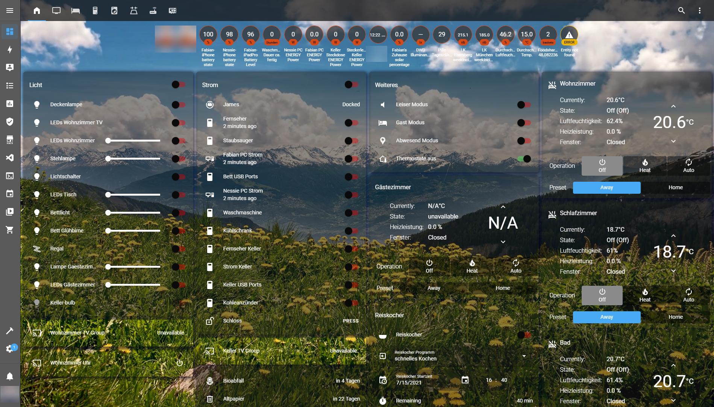
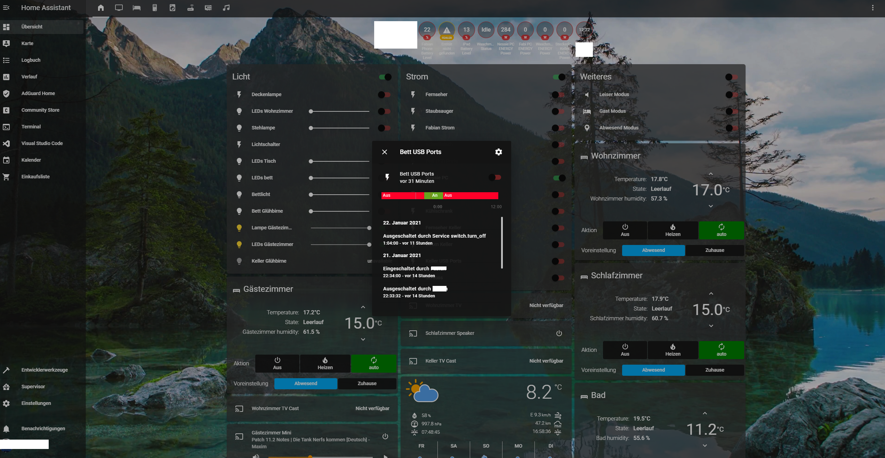
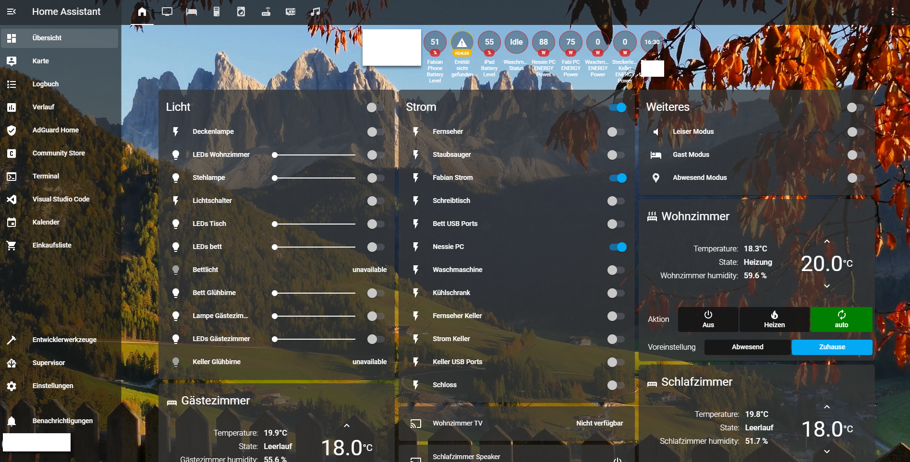

# Transparent Dark Gray Theme 🎨

A transparent dark gray theme for **Home Assistant**.

> Based on the excellent [transparentblue](https://github.com/JOHLC/transparentblue) theme.

## Features ✨

- **Transparent UI**: See your background through the cards.
- **Custom Buttons**: Styled toggles and switches.
- **Animated Backgrounds**: Designed to work with [Lovelace Animated Background](https://github.com/Villhellm/lovelace-animated-background).

## Screenshots 📸

## Installation 🛠️

### 1. Using HACS (Recommended)

1.  Open HACS.
2.  Add Custom Repository: `https://github.com/FaserF/transparentgray` (Category: Theme).
3.  Click **Download**.
4.  Select `transparentgray-LAB` in your Profile settings.

### 2. Manual Installation

1.  Download `transparentgray.yaml` (or the specific variation you want).
2.  Place it in your `themes/` directory.
3.  Add the resource reference to `configuration.yaml`.
4.  Restart Home Assistant and select the theme.

#### Changing the background image 
Have a look [here](https://github.com/JOHLC/transparentblue#changing-the-background-image)  

### Old Version
Version 2021-06-07 looked like this:
**transparentgray.yaml** 

**transparentgray-other.yaml** 
